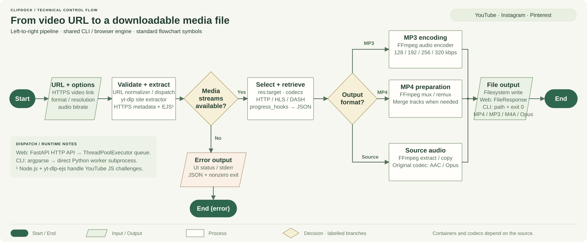

# ClipDock

[](https://github.com/Golden-alt933/clipdock/actions/workflows/tests.yml)

Download public **YouTube videos & Shorts, Instagram Reels, and Pinterest video Pins**. Use the terminal or a browser interface on your computer. Free, open source, with no ads or ClipDock account.


## Install once

You need [uv](https://docs.astral.sh/uv/getting-started/installation/), [Git](https://git-scm.com/downloads), [FFmpeg/FFprobe](https://ffmpeg.org/download.html), and [Node.js 22+](https://nodejs.org/en/download) on your PATH. The command below lets uv install Python 3.13 and ClipDock's Python dependencies for you.

Run this in **Windows PowerShell, macOS Terminal, or a Linux terminal**:

```sh
uv tool install --python 3.13 git+https://github.com/Golden-alt933/clipdock.git
clipdock doctor
```

If `clipdock` is not found, run `uv tool update-shell`, then open a new terminal. See [platform setup](docs/SETUP.md) for dependency-install commands or installation without uv.

## Download

Replace `VIDEO_URL` with a link. Keep the quotes around it.

```sh
clipdock download "VIDEO_URL"
clipdock download "VIDEO_URL" --quality 720 --output ./saved-videos
clipdock download "VIDEO_URL" --format mp3 --audio-bitrate 320
clipdock download "VIDEO_URL" --format audio
```

| Output | What you get |
| --- | --- |
| MP4 (default) | Video with audio when the source supplies it; prefers 1080p |
| MP3 | Audio conversion; 128, 192, 256, or **320 kbps** (default) |
| Source audio | The best available original audio codec, usually M4A/AAC or Opus |

Files go to `Downloads` in your current folder unless you set `--output`. A higher MP3 bitrate cannot restore detail missing from the source; choose source audio to avoid another MP3 conversion.

## Prefer buttons?

```sh
clipdock serve --open
```

Your browser opens `http://127.0.0.1:8787`. Paste a link, choose a format, and download. Press **Ctrl+C** in the terminal to stop it. Windows users who downloaded the source ZIP can also double-click **Start ClipDock.cmd**.

This command runs a **local web app**: the browser is its interface and the downloader runs on your computer. GitHub hosts the source code.

[Open the hosted demo](https://clipdock-4mt9.onrender.com) (free, limited). Instagram and Pinterest samples downloaded successfully; the tested YouTube Short still triggers a sign-in/bot check on this host. See [hosting status and deployment instructions](docs/HOSTING.md).

## How does downloading work?

A video page contains a player and information about where its media streams live. ClipDock reads that information, fetches the media, and saves a usable file.



[Open full-size PNG](docs/download-pipeline.png) · [Scalable SVG](docs/download-pipeline.svg)

- **yt-dlp** understands each platform's page and stream formats; Node.js handles JavaScript challenges needed for YouTube extraction.
- **FFmpeg** joins separate video/audio tracks or converts audio. ClipDock provides the commands, interface, queue, and progress.
- Both interfaces use the same downloader. Files and history stay local unless you explicitly deploy the hosted version.

## Limits & maintenance

Use content you own or have permission to save. Private, paid, removed, region-restricted, or sign-in-required videos may fail. Playlists, profiles, boards, and live streams are excluded. Platform changes can temporarily break extraction.

```sh
uv tool upgrade clipdock
clipdock --help
clipdock download --help
```

For development and tests, see [CONTRIBUTING.md](CONTRIBUTING.md). Changes are recorded in [CHANGELOG.md](CHANGELOG.md).

[MIT License](LICENSE). Built with [yt-dlp](https://github.com/yt-dlp/yt-dlp), [FFmpeg](https://ffmpeg.org/), FastAPI, and Uvicorn. Not affiliated with the supported platforms.
