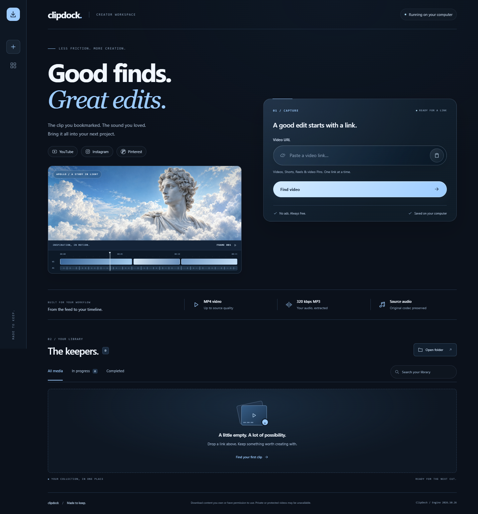

# ClipDock

[](https://github.com/Golden-alt933/clipdock/actions/workflows/tests.yml)

**Save a video. Keep a little inspiration.**

A free, open-source downloader for public **YouTube videos and Shorts, Instagram Reels/posts, and Pinterest video Pins**. Use a clean browser interface on your own computer, or download directly from a terminal.



## What you get

- MP4 video, MP3 audio at up to **320 kbps**, and **best source audio** in its native codec.
- MP3 bitrate choices: 128, 192, 256, or 320 kbps (default).
- Video resolution preferences: 360p, 720p, 1080p, 4K, or best available; supports portrait Reels and Shorts.
- Two concurrent downloads, a queue, progress, cancellation, retry, and local history.
- A local browser interface and a `clipdock` command for Windows, Linux, and macOS.
- No subscription, ads, paid API, ClipDock account, analytics, or cloud relay.

## Is this a website I can visit?

ClipDock is a **local web app**: a small Python service runs on your computer and serves its interface at `http://127.0.0.1:8787`. Your browser is the interface; downloading happens on your machine.

This GitHub repository shares the source code. Visiting the repo does **not** start the app. Clone or install it using the instructions below. Other users run their own copy, independently of your computer.

GitHub Pages cannot run ClipDock's Python backend or FFmpeg. A public, install-free download website would require a separately hosted backend and additional service design. This repository does not deploy one.

## Requirements

- **Python 3.11 or newer**.
- **FFmpeg and FFprobe**, available on your `PATH`.
- **Node.js 22 or newer**, available on your `PATH`, for YouTube extraction.
- Internet access to the source video services.

The Python installation includes [yt-dlp](https://github.com/yt-dlp/yt-dlp) and its JavaScript challenge solver. FFmpeg/FFprobe and Node.js are separate system tools; installing ClipDock does not install them.

### Linux: Ubuntu / Debian

Install system requirements:

```bash
sudo apt update
sudo apt install git python3 python3-venv ffmpeg
```

Install [Node.js 22+](https://nodejs.org/en/download) if it is not already available. Some distributions package an older Node.js version; check `node --version` before continuing. Python must be 3.11+ (`python3 --version`).

Clone and run:

```bash
git clone https://github.com/Golden-alt933/clipdock.git
cd clipdock
python3 -m venv .venv
source .venv/bin/activate
python -m pip install .
clipdock doctor
clipdock serve --open
```

Open `http://127.0.0.1:8787` if the browser does not open automatically. Press **Ctrl+C** in the terminal to stop the service. On a headless machine, omit `--open`; direct downloads do not need a browser.

### Already have uv?

With [uv](https://docs.astral.sh/uv/getting-started/installation/), Python, FFmpeg/FFprobe, Node.js, and Git available, run the interface from the public repo:

```bash
uvx --from git+https://github.com/Golden-alt933/clipdock.git clipdock serve --open
```

Or install the command for repeated use:

```bash
uv tool install git+https://github.com/Golden-alt933/clipdock.git
clipdock doctor
clipdock serve --open
```

This uses the Git repository directly; ClipDock has not been published to PyPI. Do not assume `pip install clipdock` installs this project.

### Windows

Install [Python](https://www.python.org/downloads/), [FFmpeg](https://ffmpeg.org/download.html), and [Node.js](https://nodejs.org/) and make them available on `PATH`. Windows Package Manager can install them:

```powershell
winget install Python.Python.3.13
winget install Gyan.FFmpeg
winget install OpenJS.NodeJS.LTS
```

Open a new terminal after installation. Clone this repo, or choose **Code → Download ZIP** on GitHub and extract it. Double-click **Start ClipDock.cmd**. The launcher sets up a private `.venv`, starts the service in the background, and opens your browser.

Use **Stop ClipDock.cmd** to stop it. Closing the browser alone leaves the service running. ClipDock does not start automatically with Windows.

Terminal installation is also supported:

```powershell
py -m venv .venv
.venv\Scripts\python.exe -m pip install .
.venv\Scripts\clipdock.exe doctor
.venv\Scripts\clipdock.exe serve --open
```

### macOS

With Python 3.11+, Git, FFmpeg/FFprobe, and Node.js 22+ installed, use the Linux clone/virtual-environment commands above. On Homebrew, the system tools are available through `brew install python ffmpeg node git`.

## Download from the terminal

Once installed, download without starting the browser interface:

```bash
clipdock download "https://www.youtube.com/shorts/q6ZqeyEh64A"
clipdock download "https://www.youtube.com/shorts/q6ZqeyEh64A" --format mp3
clipdock download "https://www.youtube.com/shorts/q6ZqeyEh64A" --format mp3 --audio-bitrate 320
clipdock download "https://www.youtube.com/shorts/q6ZqeyEh64A" --format audio
clipdock download "https://www.youtube.com/shorts/q6ZqeyEh64A" --quality 720 --output ./saved-videos
```

Replace the example URL with a video you own or have permission to save. Instagram and Pinterest URLs use the same command. Quote URLs, especially when they contain `&` or other shell characters.

Useful commands:

```bash
clipdock --help
clipdock download --help
clipdock doctor
clipdock serve --port 8790 --data-dir ./my-clipdock-data
clipdock download "VIDEO_URL" --json
```

- Direct CLI downloads default to `./Downloads` in the current directory.
- `--output` chooses a directory, not an individual filename.
- `--format` accepts `mp4` (default), `mp3`, or `audio` (best source audio).
- `--audio-bitrate` accepts `128`, `192`, `256`, or `320` kbps; MP3 conversion defaults to `320`. MP3 filenames include the selected bitrate so a previous lower-bitrate download is not reused by mistake.
- Best source audio keeps the original codec, usually M4A/AAC or Opus, avoiding another lossy MP3 conversion. Its actual bitrate is determined by the platform, and different codecs cannot be compared by bitrate alone.
- `--quality` accepts `360`, `720`, `1080` (default), `2160`, or `best`.
- `--json` emits newline-delimited JSON events for scripts.
- Successful downloads return exit code `0`; invalid arguments or missing requirements return `2`, download failures return nonzero, and Ctrl+C returns `130`.
- `python -m clipdock` supports the same commands after installation or from the repository.

## Where do files go?

The browser interface saves videos in a `Downloads` subfolder of its data directory, with one subfolder per job. History is saved as `history.json` in the same data directory.

| Launch method / system | Default browser-app data directory |
| --- | --- |
| Windows double-click launcher | Repository folder, preserving the original local app behavior |
| Installed command on Windows | `%LOCALAPPDATA%\ClipDock` |
| Linux | `${XDG_DATA_HOME:-~/.local/share}/clipdock` |
| macOS | `~/Library/Application Support/ClipDock` |

Override this with `clipdock serve --data-dir PATH` or the `CLIPDOCK_DATA_DIR` environment variable. CLI downloads use `--output` independently of browser history. Installed package files stay separate from writable history and media.

Completed files are already saved locally. **Save copy** offers another copy through the browser's save flow. Cancelled/interrupted partial files are retained; the app does not delete your files automatically.

## Supported links and limits

- Single YouTube videos and Shorts, public Instagram Reels/posts, and Pinterest video Pins, including `pin.it` links.
- Boards, profiles, playlists, image-only Pins, and live/upcoming streams are excluded.
- For multi-item posts, the first item must contain video.
- Private, removed, paid, protected, sign-in-required, rate-limited, or region-restricted videos may not work. There is no account-password or browser-cookie import feature.
- Video quality uses the shorter dimension, so a 1080x1920 Reel counts as 1080p. ClipDock prefers the largest available resolution up to your choice, or the smallest available if every stream is larger; it does not upscale. This prevents portrait Reels being rejected by an inappropriate height-only filter.
- A 320 kbps MP3 cannot restore quality missing from the source. For source fidelity, choose **Best source audio**. MP4 codecs depend on the source; some files may contain AV1.
- Audio is included when the source supplies it; silent source videos remain silent.
- Sites change. yt-dlp support does not guarantee every link will work.

## Privacy and local use

ClipDock listens on **127.0.0.1 only**. It is designed for one user's local computer. Video pages, streams, and preview thumbnails are fetched from the source services. Source links and download history stay on disk locally.

The interface uses a per-process request token, local hostname checks, and a Content Security Policy. These are local-use protections, not multi-user hosting authentication. Do not expose this service publicly as-is.

Downloaded media, local history, virtual environments, logs, and environment files are excluded from Git. Save content you own or have permission to download and follow the source platform's terms.

## Update the download engine

Stop the app first. In the environment where ClipDock is installed:

```bash
python -m pip install --upgrade "yt-dlp[default]"
```

For `uv tool` installs, update the tool and its dependencies:

```bash
uv tool upgrade clipdock
```

For the Windows double-click setup, use **Update downloader.cmd**.

## Development

```bash
python -m pip install -e ".[test]"
python -m unittest discover -s tests -v
python -m clipdock serve
```

Tests use temporary data and mocks rather than downloading platform media in CI. The CI matrix covers Windows and Linux on Python 3.11 and 3.13. Live service behavior must be checked separately. See [CONTRIBUTING.md](CONTRIBUTING.md) and [CHANGELOG.md](CHANGELOG.md).

## How it works

```text
Browser / CLI → validate URL → isolated yt-dlp worker
                                  ↓
                          discover media streams
                                  ↓
                          download + FFmpeg processing
                                  ↓
                              local file
```

The FastAPI service owns the queue/history; each active download runs in a separate process so cancellation can stop its downloader and FFmpeg subprocesses. The terminal command reuses the same worker. The interface is plain HTML/CSS/JavaScript with no frontend build step.

## License and acknowledgments

ClipDock's source is licensed under the [MIT License](LICENSE). Dependencies retain their own licenses. Built with [yt-dlp](https://github.com/yt-dlp/yt-dlp), [FFmpeg](https://ffmpeg.org/), [FastAPI](https://fastapi.tiangolo.com/), and [Uvicorn](https://www.uvicorn.org/). This project is not affiliated with YouTube, Instagram, or Pinterest.
